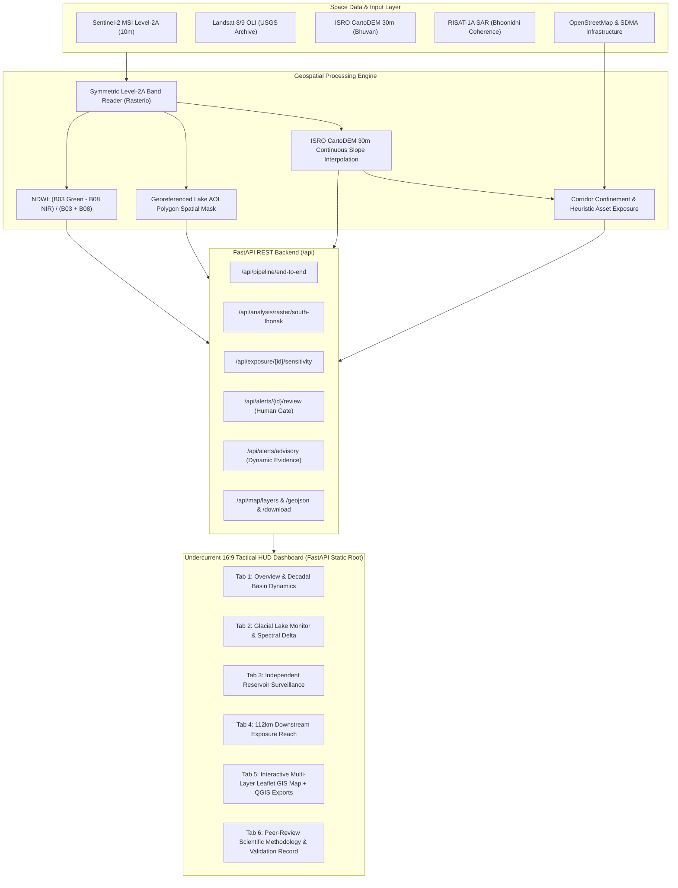

# UNDERCURRENT 🌊
### Himalayan Water Intelligence & Glacial Risk Monitoring System
**Satellite-Data-Driven Geospatial Intelligence Platform**

[](https://www.python.org/)
[](https://fastapi.tiangolo.com/)
[](https://rasterio.readthedocs.io/)
[](https://scipy.org/)
[](https://leafletjs.com/)
[](https://bhuvan.nrsc.gov.in/)
[](https://dataspace.copernicus.eu/)

---

## 📌 Project Positioning & Ethical Disclaimer

> [!IMPORTANT]
> **Undercurrent** is a satellite-data-driven decision-support prototype for monitoring water-body changes and preliminary downstream exposure screening. 
> It is **not** an operational GLOF early-warning system, a validated hydrodynamic flood forecast, or an operational warning authority. Official emergency directives remain exclusively under state and national disaster management authorities (Sikkim SDMA / NDMA).

---

## 🏔️ Overview

Himalayan mountain basins house thousands of glacial lakes perched thousands of meters above populated valleys, hydropower reservoirs, and transport corridors. In October 2023, the catastrophic outburst of **South Lhonak Glacial Lake** in Sikkim swept through the Teesta River gorge, breaching the **1,200 MW Chungthang Dam (Teesta-III)** and destroying critical bridges and sections of National Highway 10.

Historically, satellite imagery, digital elevation models, and reservoir water records exist in disconnected silos. **Undercurrent** solves this gap by integrating three interconnected analytical views into a single basin-oriented workflow:
1. **Glacial Lake Change Monitoring:** Multi-date satellite boundary extraction, symmetric Sentinel-2 B03/B08 NDWI calculation, exact affine transform ground area metrics, and breach detection.
2. **Reservoir Water-Spread Monitoring:** Seasonal surface-area variation tracking with explicit distinction between 2D water-spread area and 3D storage volume.
3. **Downstream Exposure Screening:** DEM-derived slope and drainage profiling, gorge confinement buffering, and vulnerable asset intersection mapping with weight sensitivity testing.

---

## 🛰️ Space Data & Remote Sensing Domain Focus

| Domain Focus | Undercurrent Contribution | System Implementation |
| :--- | :--- | :--- |
| **01 \| Indian Space Missions & Space Data** | Uses Indian satellite missions and portals for elevation and radar verification. | Integrated **ISRO CartoDEM (30m)** via Bhuvan for elevation/slope profiling and **ISRO Bhoonidhi RISAT-1A SAR** coherence data. |
| **02 \| Earth Observation & Satellite Applications** | Extracts multi-date water boundaries, computes NDWI, and visualizes decadal expansion. | Symmetric **Sentinel-2 MSI Level-2A (10m)** raster pipeline with georeferenced AOI polygon spatial masking and interactive threshold simulator. |
| **03 \| Space-Based Disaster Management** | Traces downstream river corridors, buffers gorge confinement, and screens infrastructure exposure. | 112.4 km drainage network overlay from South Lhonak to Rangpo, intersecting 8 critical settlements, dams, and highway links with location-specific DEM slopes. |

---

## 🏗️ System Architecture & Unified Frontend

Project Undercurrent utilizes a streamlined, highly optimized architecture where the **FastAPI backend directly serves the single production Operational Dashboard** at `http://localhost:8000/`.



---

## 📁 Required Satellite Rasters & Data Directory

The physical raster processing engine (`process_real_satellite_raster`) requires the raw Sentinel-2 Level-2A GeoTIFF files located in `data/raw/satellite/`:

| Date | File Name | Band / Description | Projection | Resolution |
| :--- | :--- | :--- | :--- | :--- |
| **2023-09-26** (Pre-burst) | `2023-09-26_B03.tiff.tiff` | Band 3 (Green, 560nm) | EPSG:32645 (UTM 45N) | 10.0m GSD |
| **2023-09-26** (Pre-burst) | `2023-09-26_B08.tiff.tiff` | Band 8 (NIR, 842nm) | EPSG:32645 (UTM 45N) | 10.0m GSD |
| **2023-10-09** (Post-burst) | `2023-10-09_B03.tiff.tiff` | Band 3 (Green, 560nm) | EPSG:32645 (UTM 45N) | 10.0m GSD |
| **2023-10-09** (Post-burst) | `2023-10-09_B08.tiff.tiff` | Band 8 (NIR, 842nm) | EPSG:32645 (UTM 45N) | 10.0m GSD |

Both dates share:
* **Spatial Reference:** WGS 84 / UTM Zone 45N (`EPSG:32645`).
* **True Pixel Area:** $100.02\text{ m}^2$ derived directly from the raster affine transform.
* **Georeferenced AOI:** Evaluated within the canonical South Lhonak lake basin polygon (`data/processed/south_lhonak_boundaries.geojson`).

---

## ⚡ Quickstart Guide

### 1. Installation
Install pinned dependencies from `backend/requirements.txt`:

```powershell
pip install -r backend/requirements.txt
```

### 2. Run Test Suite
Validate dependency imports, synthetic fixture processing (NoData, CRS mismatch, empty components), and all API routes:

```powershell
python tests/test_dependencies.py
python tests/test_raster_processing.py
python tests/test_api.py
```

### 3. Start the Application
Run the FastAPI application from the project root:

```powershell
python -m uvicorn backend.app.main:app --host 127.0.0.1 --port 8000 --reload
```

Open your browser to:
* **Interactive Operations HUD:** [http://localhost:8000/](http://localhost:8000/)
* **Interactive API Documentation:** [http://localhost:8000/api/docs](http://localhost:8000/api/docs)
* **ReDoc Documentation:** [http://localhost:8000/api/redoc](http://localhost:8000/api/redoc)

---

## 🎬 Recommended Demonstration Narrative (Section 10 Action Plan)

When presenting or demonstrating Project Undercurrent, follow this verified 6-step walkthrough:

1. **Input Scenes & Metadata:** Open South Lhonak Lake on Tab 2. Point out the exact Copernicus Sentinel-2 Level-2A input scenes (26-Sep-2023 and 09-Oct-2023), UTM Zone 45N projection, and 10.0m spatial resolution.
2. **Symmetric Reproducible Lake Classification:** Show that both dates pass through identical Band 3 (Green) and Band 8 (NIR) NDWI calculations and georeferenced AOI polygon spatial masking (no hardcoded row/column pixel crops).
3. **Water Mask, Lake Boundary & Ground Truth Area:** Display the pre-burst lake extent ($1.666\text{ km}^2$, 16,660 pixels) alongside the post-burst stabilized residual extent ($0.976\text{ km}^2$, 9,762 pixels), showing the $-41.4\%$ surface drainage loss with $100.0\%$ valid data coverage and $0.0\%$ cloud cover.
4. **Basin Drainage Context & Exposure Screening:** Switch to Tab 4 (Exposure). Trace the 112.4 km Teesta drainage line from $5,200\text{ m}$ to $280\text{ m}$. Show how local DEM slopes are dynamically interpolated from the ISRO CartoDEM valley profile ($22.0^\circ$ at Chungthang Dam vs $6.8^\circ$ at Rangpo), and review the weight sensitivity rank stability matrix.
5. **Independent Reservoir Surveillance Track:** Switch to Tab 3 (Reservoirs). Highlight the Chungthang Dam ($0.512\text{ km}^2 \rightarrow 0.241\text{ km}^2$) and Dikchu Dam as an independent observation track, emphasizing that 2D water-spread loss is not equivalent to storage volume without rating curves.
6. **Traceable Evidence Advisory with Human Review Gate:** Navigate to the Advisory panel. Review the automatically compiled multi-factor evidence advisory, and demonstrate the human review approval gate (`POST /api/alerts/ALT-2023-SK-01/review`) requiring official SDMA/NDMA sign-off before elevation to external stakeholders.

---

## 🔬 Scientific Methodology Summary

### 1. Normalized Difference Water Index (NDWI)
$$\text{NDWI} = \frac{\text{Green} - \text{NIR}}{\text{Green} + \text{NIR}} = \frac{\text{B03} - \text{B08}}{\text{B03} + \text{B08}}$$

### 2. Physical Ground Area from Affine Transform
$$\text{Pixel Area } (\text{m}^2) = |\Delta x| \times |\Delta y| \approx 9.995\text{ m} \times 10.007\text{ m} = 100.02\text{ m}^2$$
$$\text{Lake Area } (\text{km}^2) = \frac{\sum \text{Water Pixels} \times 100.02\text{ m}^2}{10^6}$$

### 3. Percentage Surface Area Change
$$\% \text{ Area Change} = \left(\frac{A_{\text{later}} - A_{\text{earlier}}}{A_{\text{earlier}}}\right) \times 100$$

---

## ⚖️ Responsible Scientific Claims

* **Say:** *"Observed lake surface area contracted between these dates."*  
  *(Do not say: "The lake is about to burst.")*
* **Say:** *"This is a preliminary downstream exposure screening layer."*  
  *(Do not say: "This is the predicted hydrodynamic flood wave.")*
* **Say:** *"The reservoir's mapped water-spread area varied."*  
  *(Do not say: "Reservoir storage fell by X million cubic meters.")*
* **Say:** *"This prototype supports situational awareness."*  
  *(Do not say: "This replaces official disaster management warning authorities.")*

---

## 📜 License
Open-source under the MIT License. Geospatial data attributed to ISRO Bhuvan, Copernicus Data Space Ecosystem, USGS EarthExplorer, and OpenStreetMap.
