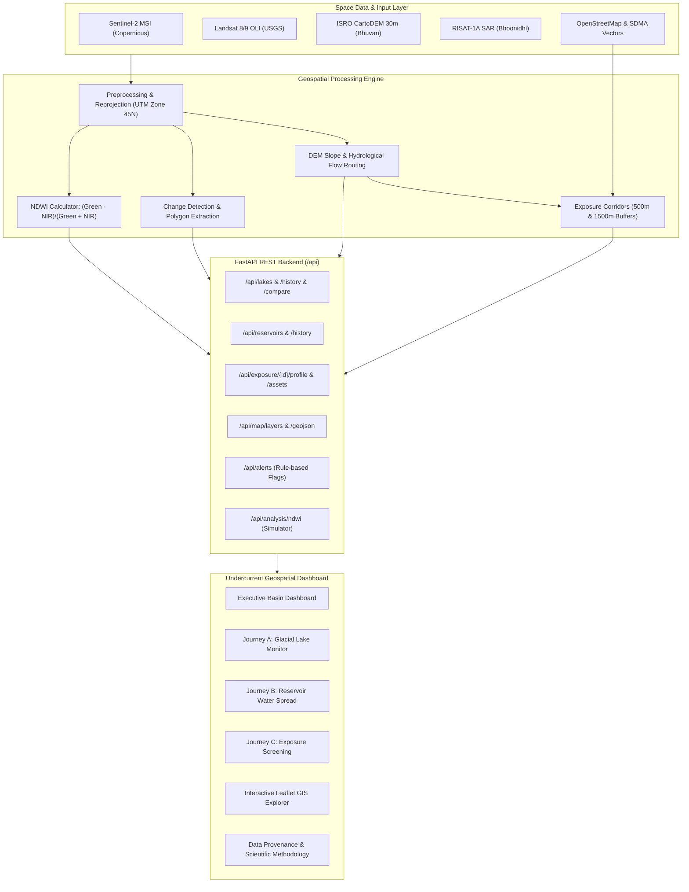

# UNDERCURRENT 🌊
### Himalayan Water Intelligence & Glacial Risk Monitoring System
**Satellite-Data-Driven Geospatial Intelligence Platform**

[](https://www.python.org/)
[](https://fastapi.tiangolo.com/)
[](https://react.dev/)
[](https://leafletjs.com/)
[](https://bhuvan.nrsc.gov.in/)
[](https://dataspace.copernicus.eu/)

---

## 📌 Project Positioning & Ethical Disclaimer

> [!IMPORTANT]
> **Undercurrent** is a satellite-data-driven decision-support prototype for monitoring water-body changes and preliminary downstream exposure screening. 
> It is **not** an operational GLOF early-warning system, a validated flood forecast, or a substitute for official disaster-management and hydrological authorities.

---

## 🏔️ Overview

Himalayan mountain basins house thousands of glacial lakes perched thousands of meters above populated valleys, hydropower reservoirs, and transport corridors. In October 2023, the catastrophic outburst of **South Lhonak Glacial Lake** in Sikkim swept through the Teesta River gorge, breaching the **1,200 MW Chungthang Dam (Teesta-III)** and destroying critical bridges and sections of National Highway 10.

Historically, satellite imagery, digital elevation models, and reservoir water records exist in disconnected silos. **Undercurrent** solves this gap by integrating three interconnected analytical views into a single basin-oriented workflow:
1. **Glacial Lake Change Monitoring:** Multi-date satellite boundary extraction, NDWI calculation, area change metrics, and breach detection.
2. **Reservoir Water-Spread Monitoring:** Seasonal surface-area variation tracking with explicit distinction between water-spread area and storage volume.
3. **Downstream Exposure Screening:** DEM-derived slope and drainage profiling, gorge confinement buffering, and vulnerable asset intersection mapping.

---

## 🛰️ Space Data & Remote Sensing Domain Focus

| Domain Focus | Undercurrent Contribution | System Implementation |
| :--- | :--- | :--- |
| **01 \| Indian Space Missions & Space Data** | Uses Indian satellite missions and portals for elevation and radar verification. | Integrated **ISRO CartoDEM (30m)** via Bhuvan for elevation/slope profiling and **ISRO Bhoonidhi RISAT-1A SAR** coherence data. |
| **02 \| Earth Observation & Satellite Applications** | Extracts multi-date water boundaries, computes NDWI, and visualizes decadal expansion. | Automated **Sentinel-2 MSI (10m)** and **Landsat-8/9 (30m)** analysis pipeline with interactive threshold simulator. |
| **03 \| Space-Based Disaster Management** | Traces downstream river corridors, buffers gorge confinement, and screens infrastructure exposure. | 112 km drainage network overlay from South Lhonak to Rangpo, intersecting 8 critical settlements, dams, and highway links. |

---

## 🏗️ System Architecture



---

## ⚡ Quickstart Guide

### 1. Prerequisites
* Python 3.10+ installed.
* All core dependencies (`fastapi`, `uvicorn`, `pydantic`, `numpy`, `pandas`) are standard Python packages.

### 2. Run the Application
From the workspace root directory:

```powershell
# Start the FastAPI server (serves both API and Interactive UI)
python -m uvicorn backend.app.main:app --host 0.0.0.0 --port 8000 --reload
```

Open your browser to:
* **Interactive Web Dashboard:** [http://localhost:8000/](http://localhost:8000/)
* **Interactive Swagger API Documentation:** [http://localhost:8000/api/docs](http://localhost:8000/api/docs)
* **ReDoc Documentation:** [http://localhost:8000/api/redoc](http://localhost:8000/api/redoc)

---

## 📂 Repository Structure

```
Undercurrent/
├── backend/
│   ├── app/
│   │   ├── main.py                  # FastAPI application entry & static mount
│   │   ├── routes/
│   │   │   ├── health.py            # /api/health
│   │   │   ├── lakes.py             # Glacial lake multi-date endpoints
│   │   │   ├── reservoirs.py        # Reservoir water-spread endpoints
│   │   │   ├── exposure.py          # Exposure screening & DEM profile
│   │   │   ├── maps.py              # Map layer catalog & GeoJSON serving
│   │   │   ├── alerts.py            # Rule-based screening anomaly flags
│   │   │   └── analysis.py          # Interactive NDWI calculation engine
│   │   ├── services/
│   │   │   ├── data_service.py      # Geospatial cache & GeoJSON loaders
│   │   │   ├── geospatial.py        # Geodesic distances, % change & exposure
│   │   │   └── ndwi_engine.py       # NDWI matrix classification & simulation
│   │   ├── schemas/
│   │   │   └── models.py            # Pydantic models conforming to blueprint
│   │   └── static/
│   │       └── index.html           # Full interactive geospatial web application
│   └── requirements.txt
├── frontend/
│   ├── src/
│   │   ├── App.jsx                  # React component implementation
│   │   ├── main.jsx                 # React root entry
│   │   └── services/api.js          # API client connector
│   ├── package.json
│   ├── vite.config.js
│   └── index.html
├── data/
│   ├── raw/                         # Raw satellite and DEM archives
│   ├── processed/
│   │   ├── south_lhonak_boundaries.geojson  # Multi-date lake polygons
│   │   ├── chungthang_reservoir.geojson     # Reservoir water-spread polygons
│   │   ├── teesta_v_reservoir.geojson       # Downstream dam reservoir
│   │   ├── teesta_river_drainage.geojson    # 112km stream flowline
│   │   ├── teesta_exposure_corridor.geojson # 500m & 1500m screening buffers
│   │   ├── downstream_assets.geojson        # 8 settlements & infrastructure
│   │   └── elevation_profile.json           # DEM elevation points & slope
│   └── metadata/
│       └── data_catalogue.json      # Complete sensor provenance & licences
├── docs/
│   ├── UNDERCURRENT_PROJECT_BLUEPRINT.md  # Comprehensive 17-section blueprint
│   ├── ASTRA_PRESENTATION_SCRIPT.md       # 5-10 minute pitch & judge defense guide
│   └── METHODOLOGY_AND_DATA_SOURCES.md    # NDWI mathematics & ISRO space data
└── README.md
```

---

## 🔬 Scientific Methodology Summary

### Water Extraction (NDWI)
$$\text{NDWI} = \frac{\text{Green} - \text{NIR}}{\text{Green} + \text{NIR}}$$
Using Sentinel-2 Band 3 ($560\text{ nm}$) and Band 8 ($842\text{ nm}$). Water pixels classified above threshold $\theta \approx 0.14$.

### Area Change Formula
$$\% \text{ Area Change} = \left(\frac{A_{\text{later}} - A_{\text{earlier}}}{A_{\text{earlier}}}\right) \times 100$$
All geometries projected into **UTM Zone 45N (EPSG:32645)** to calculate true planar surface area.

### South Lhonak Historical Observations
* **2013-10-18:** $0.984\text{ km}^2$ (Landsat-8 reference baseline)
* **2019-10-05:** $1.348\text{ km}^2$ (+37.0% steady expansion)
* **2021-10-12:** $1.492\text{ km}^2$ (+51.6% high melt impoundment)
* **2023-09-17:** $1.682\text{ km}^2$ (+70.9% pre-outburst maximum)
* **2023-10-04:** $1.031\text{ km}^2$ (**-38.7%** post-breach drainage, net loss of $0.651\text{ km}^2$)

---

## 👥 Hackathon Team Structure

| Team Member | Role | Core Deliverables |
| :--- | :--- | :--- |
| **Aerospace Member** | Remote Sensing & Scientific Analysis Lead | Image selection (Bhuvan, Copernicus), QGIS validation, scientific disclaimer governance, and judge defense on remote sensing. |
| **CS Member 1** | Geospatial Processing & AI Engineer | Automated NDWI processing pipeline, raster matrix thresholding, area calculation algorithms. |
| **CS Member 2** | Backend & Data Engineer | FastAPI architecture, REST endpoints, metadata catalogue, Pydantic schemas, and data caching. |
| **CS Member 3** | Frontend & Product Engineer | Responsive web interface, Leaflet interactive GIS map, Chart.js telemetry charts, demo rehearsal. |

---

## ⚖️ Responsible Presentation Guidelines

* **Say:** *"Observed lake surface area increased between these dates."*  
  *(Do not say: "The lake is about to burst.")*
* **Say:** *"This is a preliminary downstream exposure screening layer."*  
  *(Do not say: "This is the predicted flood inundation wave.")*
* **Say:** *"The reservoir's mapped water-spread area varied."*  
  *(Do not say: "Reservoir storage fell by X million cubic meters.")*
* **Say:** *"This prototype supports situational awareness."*  
  *(Do not say: "This replaces official emergency warning authorities.")*

---

## 📜 License
Open-source under the MIT License. Geospatial data attributed to ISRO Bhuvan, Copernicus Data Space Ecosystem, USGS EarthExplorer, and OpenStreetMap.
