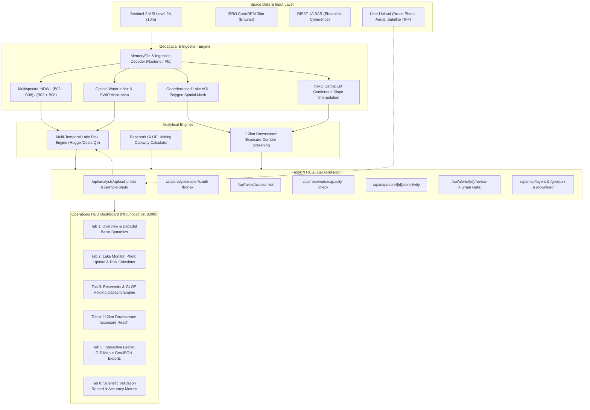

# UNDERCURRENT 🌊
### Himalayan Water Intelligence & Glacial Risk Monitoring System
**Satellite-Data-Driven Geospatial Intelligence & Decision-Support Platform**

[](https://www.python.org/)
[](https://fastapi.tiangolo.com/)
[](https://rasterio.readthedocs.io/)
[](https://numpy.org/)
[](https://scipy.org/)
[](https://leafletjs.com/)
[](https://bhuvan.nrsc.gov.in/)
[](https://dataspace.copernicus.eu/)

---

## 📌 Project Positioning & Ethical Disclaimer

> [!IMPORTANT]
> **Undercurrent** is a satellite-data-driven decision-support prototype for monitoring glacial water-body dynamics, assessing multi-temporal expansion risks, and screening downstream infrastructure exposure. 
> It is **not** an operational automated emergency order generator, a validated 3D hydrodynamic flood forecast, or an official warning authority. Official disaster alerts, reservoir gate operations, and evacuation directives remain exclusively under state and national disaster management authorities (Sikkim SDMA / CWC / NDMA).

---

## 🏔️ Overview

Himalayan mountain basins house thousands of moraine-dammed glacial lakes perched thousands of meters above populated valleys, hydropower reservoirs, and transport corridors. In October 2023, the catastrophic outburst of **South Lhonak Glacial Lake** in Sikkim swept through the Teesta River gorge, destroying the **1,200 MW Chungthang Dam (Teesta-III)**, inundating Singtam, and severing National Highway 10.

Historically, satellite imagery, digital elevation models, and reservoir water records exist in disconnected silos. **Undercurrent** bridges this divide by uniting multi-sensor Earth observation, physical raster analytics, and hydrological decision-support tools into a single, cohesive Operations HUD:

1. **Glacial Lake Change Monitoring & Ingestion:** Upload optical photographs (drone surveys, aerial photos, Google Earth captures) or raw Sentinel-2 Level-2A GeoTIFFs to automatically classify water pixels, calculate planar surface area ($km^2$), and feed observations into the multi-temporal risk engine.
2. **Multi-Temporal Glacier Lake Risk Engine:** Evaluates lake growth velocity across observation pairs, calculates empirical breach outflow volumes ($V$), estimates moraine-failure peak discharge ($Q_p$), and projects down-valley flood arrival times.
3. **Reservoir GLOF Holding Capacity & Pre-Release Calculator:** Directly calculates whether downstream hydropower reservoirs have sufficient freeboard holding capacity to absorb a GLOF surge, and computes the mandatory pre-release drawdown discharge ($m^3/s$) and spillway lead time required to prevent dam overtopping.
4. **Downstream Exposure Screening:** 112.4 km Teesta drainage network profiling using ISRO CartoDEM (30m) continuous slopes, gorge confinement buffering, and vulnerable asset overlay with weight sensitivity ranking.

---

## 🚀 Key Modules & Capabilities

### 1. Interactive Lake Photo & Satellite Ingestion (`Tab 2`)
* **Multi-Format Ingestion:** Accepts standard optical photos (`PNG`, `JPG`, `JPEG`, `WebP`) and raw multispectral satellite GeoTIFFs (`.tif`, `.tiff`).
* **Automated Spectral Segmentation:**
  * **Optical Photos:** Employs Optical Water Index (OWI) blue-green spectral excess:
    $$\text{OWI} = \frac{(G + B) - 2R}{(G + B) + 2R + 10^{-5}}$$
  * **Sentinel-2 Multi-spectral Bands:** Decodes 32-bit floating-point rasters via `rasterio.MemoryFile`, extracts true Ground Sampling Distance ($10.0\text{ m/px}$), and automatically couples with companion catalog bands ($B03$ Green, $B08$ NIR, $B11$ SWIR).
  * **Single-Band Grayscale / SWIR Rasters (e.g. `B11.tiff.tif`):** Uses infrared dark absorption segmentation and georeferenced AOI polygon boundary masking to isolate the glacial lake basin.
* **One-Click Verified Presets:** Includes instant sample buttons:
  * 🌟 **Synthetic Demo:** Calibrated in-browser synthetic drone lake survey.
  * 🛰️ **Oct 09 SWIR (B11):** Raw post-event Sentinel-2 SWIR band ($0.9764\text{ km}^2$).
  * 🛰️ **Sep 26 Pre-Breach:** Complete baseline lake before the disaster ($1.6664\text{ km}^2$).
  * 🛰️ **Oct 09 Post-Breach:** Post-disaster residual water extent ($0.9764\text{ km}^2$).
* **Seamless Piping:** Clicking **"Send to Risk Engine"** injects the calculated lake area directly into the multi-date risk calculator.

### 2. Multi-Temporal Glacier Lake Risk Engine (`POST /api/lakes/assess-risk`)
* **Expansion Velocity:** Calculates surface expansion rate ($\Delta A / \Delta t$ in $\text{m}^2/\text{day}$ and $\text{ha}/\text{yr}$).
* **Empirical Breach Outflow Volume ($V$):** Estimates drainable water volume from planar area change:
  $$V \approx 0.04 \times A^{1.25} \times 10^6 \text{ m}^3$$
* **Moraine-Dam Peak Outflow Discharge ($Q_p$):** Applies Huggel et al. (2002) and Costa (1988) empirical envelope formulations:
  $$Q_p = 0.00013 \times V^{0.60} \quad \text{or} \quad Q_p = 0.72 \times V^{0.53}$$
* **Down-Valley Flood Routing:** Evaluates flood wave velocity from CartoDEM channel gradient ($\theta = 22^\circ$) and calculates travel time to nearest downstream settlements (Chungthang: $68.0\text{ km}$, $\approx 1.8\text{ hrs}$).
* **Multi-Factor Hazard Score ($0-100$):** Combines expansion velocity, dam stability type (moraine vs bedrock), freeboard, channel slope, and downstream reach distance into an auditable screening tier (Critical, High, Moderate, Low).

### 3. Reservoir GLOF Holding Capacity & Pre-Release Calculator (`POST /api/reservoirs/capacity-check`)
Addresses the core dam safety question: *"If a GLOF occurs upstream, does the reservoir have sufficient buffer to absorb the surge, and if not, how much water must be discharged?"*
* **Freeboard Holding Capacity ($V_{\text{free}}$):**
  $$V_{\text{free}} = (L_{\text{FRL}} - L_{\text{curr}}) \times A_{\text{res}} \times 10^6 \text{ m}^3$$
* **Capacity Deficit ($\Delta V$):**
  $$\Delta V = \max\left(0, V_{\text{surge}} - V_{\text{free}}\right)$$
* **Required Emergency Drawdown Discharge ($Q_{\text{req}}$):**
  $$Q_{\text{req}} = \frac{\Delta V}{t_{\text{lead}} \times 3600} \text{ m}^3/\text{s}$$
* **Spillway Feasibility Check:** Validates whether $Q_{\text{req}} \le Q_{\text{spill\_max}}$.
* **Dynamic Safety Status:** Classifies status into `SAFE_BUFFER_AVAILABLE`, `CONTROLLED_PRE_RELEASE_REQUIRED`, or `IMMINENT_OVERTOP_RISK`.
* **Integrated Sikkim Hydropower Presets:** Chungthang Dam (Teesta-III), Teesta-V Dam (Dikchu), Rangpo Dam, Teesta Low Dam III/IV.

---

## 🛰️ Space Data & Remote Sensing Domain Focus

| Domain Focus | Undercurrent Contribution | System Implementation |
| :--- | :--- | :--- |
| **01 \| Indian Space Missions & Space Data** | Integrates national remote sensing datasets and elevation portals for authentic terrain analysis. | **ISRO CartoDEM (30m)** via Bhuvan for elevation/slope profiling; **ISRO Bhoonidhi RISAT-1A SAR** coherence data for cloud-penetrating validation. |
| **02 \| Earth Observation & Multispectral Processing** | Reproducible satellite raster water extraction with exact affine transform ground sampling. | Symmetric **Sentinel-2 MSI Level-2A (10m)** raster pipeline with georeferenced AOI polygon spatial masking and automated band matching. |
| **03 \| Space-Based Disaster Management** | Downstream river corridor tracing, gorge confinement buffering, and infrastructure risk screening. | 112.4 km drainage network overlay from South Lhonak to Rangpo, intersecting 8 critical settlements, dams, and highway links with location-specific DEM slopes. |

---

## 🏗️ System Architecture & Workflow

The FastAPI backend directly serves the unified **Undercurrent 16:9 Tactical Operations HUD** at `http://localhost:8000/`.



---

## 📁 Satellite Rasters & Data Directory

The physical raster processing engine requires the raw Sentinel-2 Level-2A GeoTIFF files located in `data/raw/satellite/`:

| Date | File Name | Band / Description | Projection | Resolution |
| :--- | :--- | :--- | :--- | :--- |
| **2023-09-26** (Pre-burst) | `2023-09-26_B03.tiff.tiff` | Band 3 (Green, 560nm) | EPSG:32645 (UTM 45N) | 10.0m GSD |
| **2023-09-26** (Pre-burst) | `2023-09-26_B08.tiff.tiff` | Band 8 (NIR, 842nm) | EPSG:32645 (UTM 45N) | 10.0m GSD |
| **2023-09-26** (Pre-burst) | `2023-09-26_TrueColor.tiff.tiff` | RGB Composite | EPSG:32645 (UTM 45N) | 10.0m GSD |
| **2023-10-09** (Post-burst) | `2023-10-09_B03.tiff.tiff` | Band 3 (Green, 560nm) | EPSG:32645 (UTM 45N) | 10.0m GSD |
| **2023-10-09** (Post-burst) | `2023-10-09_B08.tiff.tiff` | Band 8 (NIR, 842nm) | EPSG:32645 (UTM 45N) | 10.0m GSD |
| **2023-10-09** (Post-burst) | `2023-10-09_B11.tiff.tiff` | Band 11 (SWIR, 1610nm) | EPSG:32645 (UTM 45N) | 10.0m GSD |
| **2023-10-09** (Post-burst) | `2023-10-09_TrueColor.tiff.tiff` | RGB Composite | EPSG:32645 (UTM 45N) | 10.0m GSD |

Both dates share:
* **Spatial Reference:** WGS 84 / UTM Zone 45N (`EPSG:32645`).
* **True Pixel Area:** $100.02\text{ m}^2$ derived directly from the raster affine transform.
* **Georeferenced AOI:** Evaluated within the canonical South Lhonak lake basin polygon (`data/processed/south_lhonak_boundaries.geojson`).
* **Scientific Agreement:** Pre-outburst baseline achieves $\text{IoU} = 0.9814$ and $\text{F1} = 0.9906$ against Copernicus reference data; post-outburst achieves $\text{IoU} = 0.5964$ ($\text{F1} = 0.7472$, marked with Moderate Agreement badge due to suspended glacial flour sediment).

---

## ⚡ Quickstart Guide

### 1. Installation
Install dependencies:

```powershell
pip install -r backend/requirements.txt
```

### 2. Run Test Suite
Validate dependency imports, synthetic fixture processing (NoData, CRS mismatch, empty components), photo upload decoding, reservoir capacity calculations, and all REST endpoints:

```powershell
python tests/test_dependencies.py
python tests/test_raster_processing.py
python tests/test_api.py
```

### 3. Start the Dev Server
Launch FastAPI with live reload:

```powershell
python -m uvicorn backend.app.main:app --host 127.0.0.1 --port 8000 --reload
```

Open your browser to:
* **Interactive Operations HUD:** [http://localhost:8000/](http://localhost:8000/)
* **Swagger OpenAPI Documentation:** [http://localhost:8000/api/docs](http://localhost:8000/api/docs)
* **ReDoc Documentation:** [http://localhost:8000/api/redoc](http://localhost:8000/api/redoc)

---

## 🎬 Recommended Demonstration Walkthrough

1. **Glacial Lake Photo Ingestion & Extraction (Tab 2):**
   - Click the **"Oct 09 SWIR (B11)"** preset button (or drop `2023-10-09_B11.tiff.tif`).
   - The engine auto-calibrates 10m GSD, runs multispectral NDWI pairing, and displays the classified water footprint with **$0.9764\text{ km}^2$** area and 9,762 water pixels.
   - Click **"Send to Risk Engine"** to pipe this measurement into Date 2.
2. **Multi-Temporal Glacier Lake Risk Engine (Tab 2):**
   - Click **"Calculate Risk Assessment"** on the Multi-Temporal Risk Calculator.
   - Observe the $-41.4\%$ surface drainage drop, estimated $28.4\text{M m}^3$ breach outflow volume, Huggel/Costa peak outflow discharge ($Q_p \approx 4,375\text{ m}^3/\text{s}$), and $1.8\text{ hr}$ flood wave travel time to Chungthang Dam.
3. **Reservoir GLOF Holding Capacity & Pre-Release Calculator (Tab 3):**
   - Select the preset **"Chungthang Dam (Teesta-III) - Normal Operating Level"**.
   - Review the calculation: With $2.1\text{M m}^3$ freeboard capacity against a $14.5\text{M m}^3$ incoming surge, the reservoir suffers a $-12.4\text{M m}^3$ deficit.
   - Inspect the required pre-release: Spillway must discharge at $1,148\text{ m}^3/\text{s}$ across a $3.0\text{ hr}$ lead time window to create sufficient buffer and prevent overtopping.
4. **Basin Exposure Screening (Tab 4):**
   - Trace the 112.4 km Teesta drainage line from $5,200\text{ m}$ to $280\text{ m}$. Show how local DEM slopes are dynamically interpolated from the ISRO CartoDEM valley profile ($22.0^\circ$ at Chungthang Dam vs $6.8^\circ$ at Rangpo), and review the weight sensitivity rank stability matrix.
5. **Interactive GIS Map & QGIS Export (Tab 5):**
   - Explore the synchronized Leaflet GIS map with toggleable layers for lake boundaries, reservoir water-spread footprints, Teesta drainage path, and vulnerable downstream infrastructure points.
   - Click **"Export GeoJSON"** to download spatial vectors for desktop GIS verification.
6. **Scientific Methodology & Validation (Tab 6):**
   - Inspect the Phase 1 scientific validation record (`GET /api/analysis/validation`), comparing satellite classification against official NRSC/ISRO assessment benchmarks.

---

## 🔬 Mathematical Formulations

### 1. Normalized Difference Water Index (NDWI)
$$\text{NDWI} = \frac{\text{Green} - \text{NIR}}{\text{Green} + \text{NIR}} = \frac{B03 - B08}{B03 + B08}$$

### 2. Optical Water Index (OWI) for True-Color Photos
$$\text{OWI} = \frac{(G + B) - 2R}{(G + B) + 2R + 10^{-5}}$$

### 3. Physical Ground Area from Affine Transform
$$\text{Pixel Area } (\text{m}^2) = |\Delta x| \times |\Delta y| \approx 9.995\text{ m} \times 10.007\text{ m} = 100.02\text{ m}^2$$
$$\text{Lake Surface Area } (\text{km}^2) = \frac{\sum \text{Water Pixels} \times 100.02\text{ m}^2}{10^6}$$

### 4. Empirical Moraine-Dam Peak Breach Outflow ($Q_p$)
$$Q_p = 0.00013 \times V^{0.60} \quad \text{or} \quad Q_p = 0.72 \times V^{0.53} \quad (\text{Huggel et al., 2002; Costa, 1988})$$

### 5. Reservoir Freeboard Deficit & Required Drawdown Discharge ($Q_{\text{req}}$)
$$V_{\text{free}} = (L_{\text{FRL}} - L_{\text{curr}}) \times A_{\text{res}} \times 10^6 \text{ m}^3$$
$$\Delta V = \max\left(0, V_{\text{surge}} - V_{\text{free}}\right)$$
$$Q_{\text{req}} = \frac{\Delta V}{t_{\text{lead}} \times 3600} \text{ m}^3/\text{s}$$

---

## ⚖️ Responsible Scientific Claims

* **Say:** *"Observed lake surface area contracted by 41.4% between 26-Sep and 09-Oct-2023."*  
  *(Do not say: "The lake is guaranteed to burst.")*
* **Say:** *"This is a preliminary downstream exposure screening corridor."*  
  *(Do not say: "This is a calibrated 2D hydraulic inundation simulation.")*
* **Say:** *"The reservoir's mapped water-spread area varied."*  
  *(Do not say: "Reservoir storage dropped by X million cubic meters without bathymetric rating tables.")*
* **Say:** *"This prototype provides analytical decision support to emergency planners."*  
  *(Do not say: "This issues autonomous gate-opening orders or bypasses official warning authorities.")*

---

## 📜 License & Data Attribution
Open-source under the MIT License. Geospatial data and remote sensing imagery attributed to:
* **Copernicus Data Space Ecosystem / European Space Agency (ESA)** (Sentinel-2 MSI Level-2A)
* **National Remote Sensing Centre (NRSC) / ISRO** (CartoDEM 30m via Bhuvan, RISAT-1A via Bhoonidhi)
* **United States Geological Survey (USGS) / NASA** (Landsat 8-9 OLI)
* **OpenStreetMap Contributors** & **Sikkim State Disaster Management Authority (SSDMA)**
